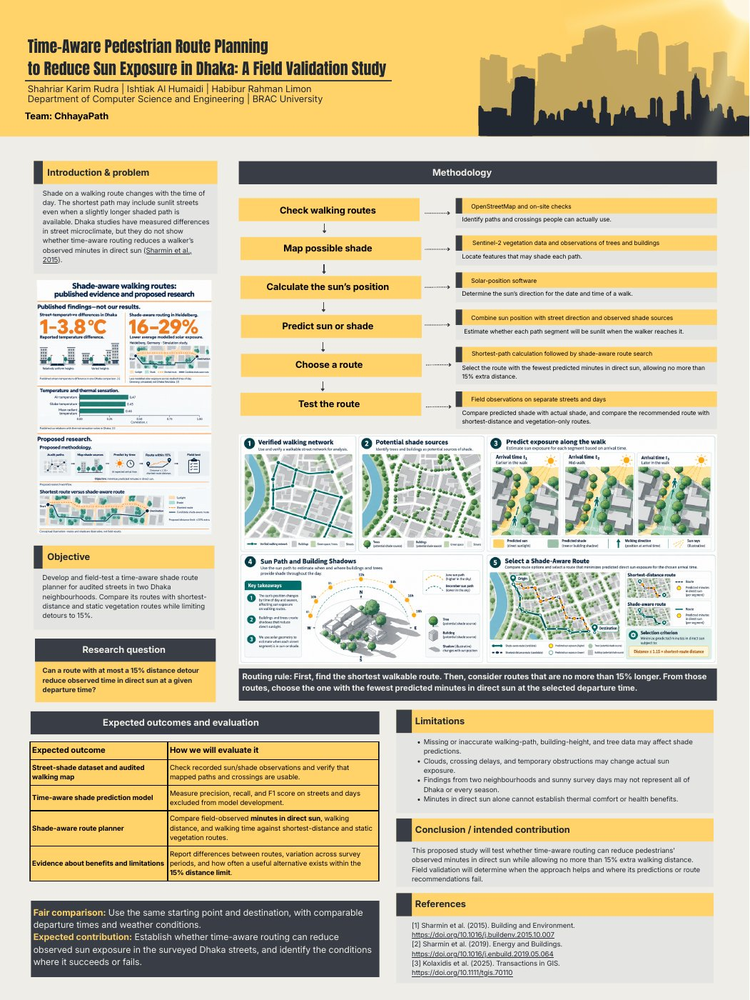

# ChhayaPath — Time-Aware Pedestrian Route Planning to Reduce Sun Exposure in Dhaka

**A Field Validation Study** · Research proposal poster

**Team ChhayaPath** — Shahriar Karim Rudra, Ishtiak Al Humaidi, Habibur Rahman Limon
Department of Computer Science and Engineering, BRAC University

Submitted to **Research Expo 2.0: Inter University Research Proposal and Datathon 2026**, organized by the Research & Publication Unit (RPU), Department of CSE, University of Asia Pacific (UAP).

[](poster/ChhayaPath_Research_Poster.pdf)

📄 **[Full poster (PDF, 36 × 48 in)](poster/ChhayaPath_Research_Poster.pdf)**

> **Status:** This is a research proposal. The study has not been carried out yet, and the repository contains no results.

---

## Problem

Shade along a walking route changes through the day. The shortest path can run along sunlit streets even when a slightly longer shaded path exists. Studies in Dhaka have measured differences in street microclimate, but they do not show whether time-aware routing reduces how many minutes a walker actually spends in direct sun (Sharmin et al., 2015).

## Research question

Can a route with at most a 15% distance detour reduce observed time in direct sun at a given departure time?

## Objective

Develop and field-test a time-aware shade route planner for audited streets in two Dhaka neighbourhoods, and compare its routes with shortest-distance and static vegetation routes while limiting detours to 15%.

## Methodology

| Step | What we do | Data / tools |
|---|---|---|
| 1. Check walking routes | Identify paths and crossings people can actually use | OpenStreetMap and on-site checks |
| 2. Map possible shade | Locate trees and buildings that may shade each path | Sentinel-2 vegetation data; observations of trees and buildings |
| 3. Calculate the sun's position | Find the sun's direction for the date and time of a walk | Solar-position software |
| 4. Predict sun or shade | Estimate whether each segment will be sunlit when the walker reaches it | Sun position + street direction + observed shade sources |
| 5. Choose a route | Pick the route with the fewest predicted minutes in direct sun, within 15% extra distance | Shortest-path search, then shade-aware route search |
| 6. Test the route | Compare predicted and actual shade; compare recommended routes with baselines | Field observations on separate streets and days |

**Routing rule:** find the shortest walkable route first. Then consider routes no more than 15% longer, and choose the one with the fewest predicted minutes in direct sun at the selected departure time.

## Expected outcomes and evaluation

| Expected outcome | How we will evaluate it |
|---|---|
| Street-shade dataset and audited walking map | Check recorded sun/shade observations and verify that mapped paths and crossings are usable |
| Time-aware shade prediction model | Precision, recall and F1 on streets and days excluded from model development |
| Shade-aware route planner | Compare field-observed minutes in direct sun, walking distance and walking time against shortest-distance and static vegetation routes |
| Evidence about benefits and limitations | Report differences between routes, variation across survey periods, and how often a useful alternative exists within the 15% limit |

**Fair comparison:** same start and destination, with comparable departure times and weather.

## Limitations

- Missing or inaccurate walking-path, building-height and tree data may affect shade predictions.
- Clouds, crossing delays and temporary obstructions may change actual sun exposure.
- Findings from two neighbourhoods and sunny survey days may not represent all of Dhaka or every season.
- Minutes in direct sun alone cannot establish thermal comfort or health benefits.

## Intended contribution

Establish whether time-aware routing can reduce observed sun exposure in the surveyed Dhaka streets, and identify where its predictions or route recommendations succeed or fail.

## References

1. Sharmin, T., et al. (2015). *Building and Environment*. https://doi.org/10.1016/j.buildenv.2015.10.007
2. Sharmin, T., et al. (2019). *Energy and Buildings*. https://doi.org/10.1016/j.enbuild.2019.05.064
3. Kolaxidis, et al. (2025). *Transactions in GIS*. https://doi.org/10.1111/tgis.70110

## Repository contents

```
.
├── README.md
├── CITATION.cff
├── LICENSE
└── poster/
    ├── ChhayaPath_Research_Poster.pdf   # full-resolution poster
    └── poster_preview.jpg               # preview image used above
```

## Citation

If you refer to this proposal, please cite it using the metadata in [`CITATION.cff`](CITATION.cff) (GitHub shows a "Cite this repository" button).

## License

The poster and text in this repository are shared under [CC BY 4.0](LICENSE). Figures from the cited studies remain the property of their original authors.
